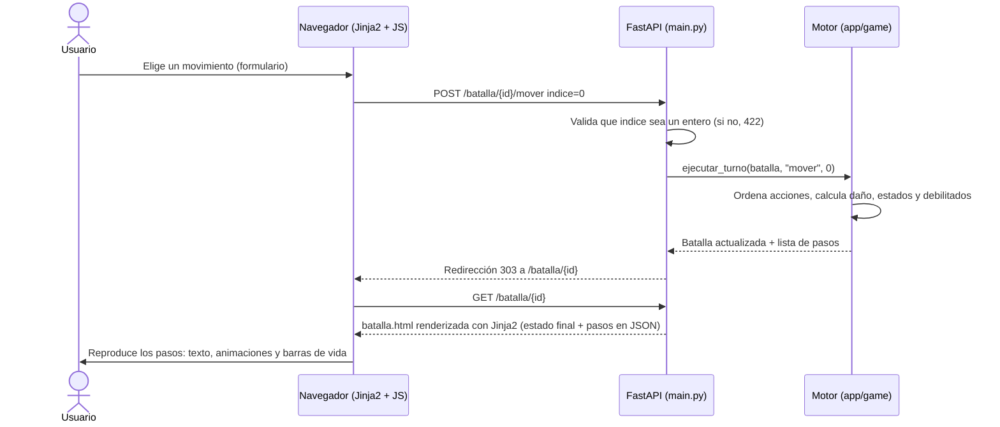
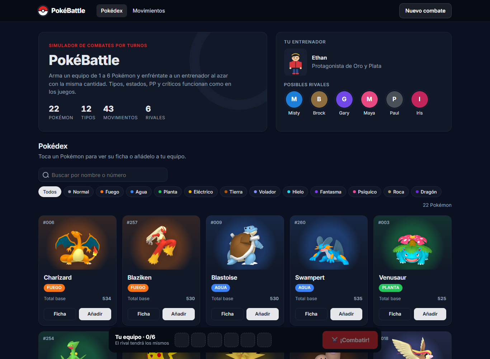
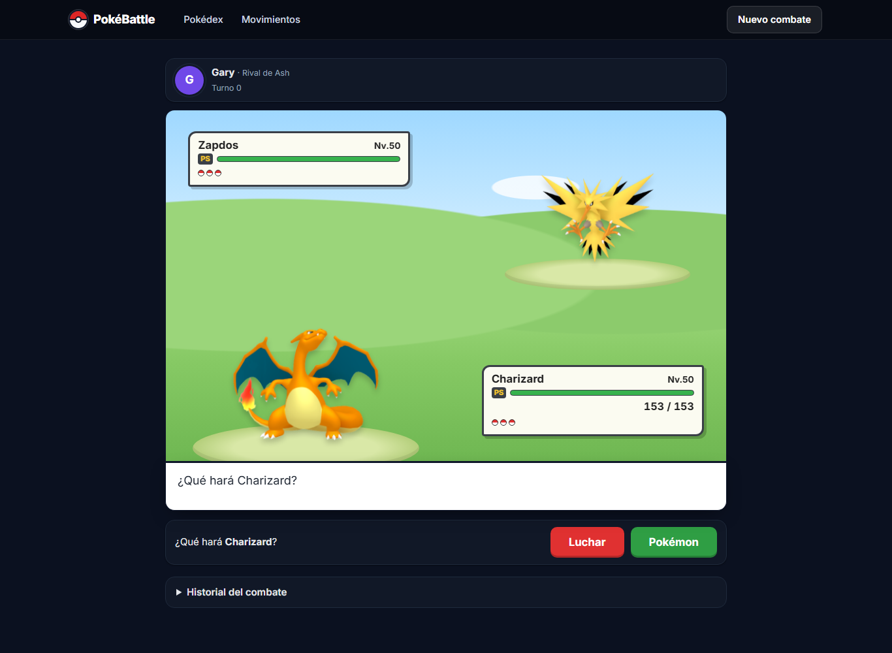
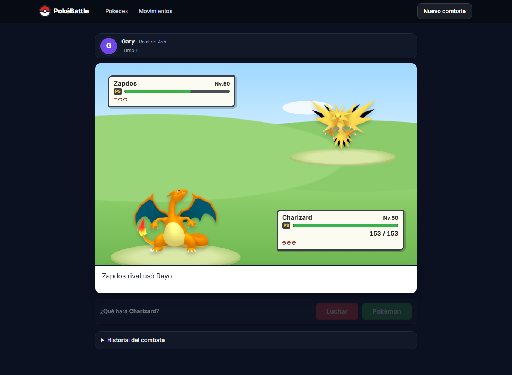
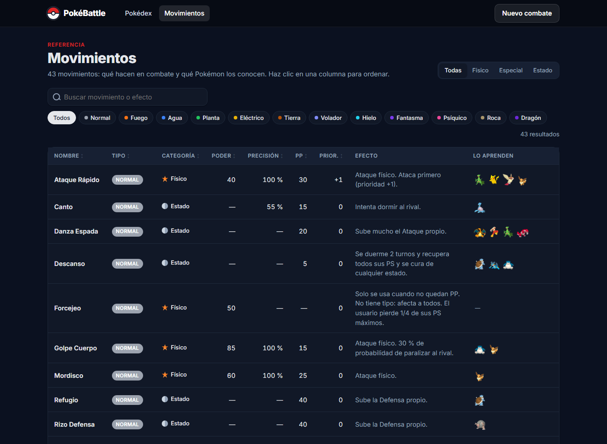
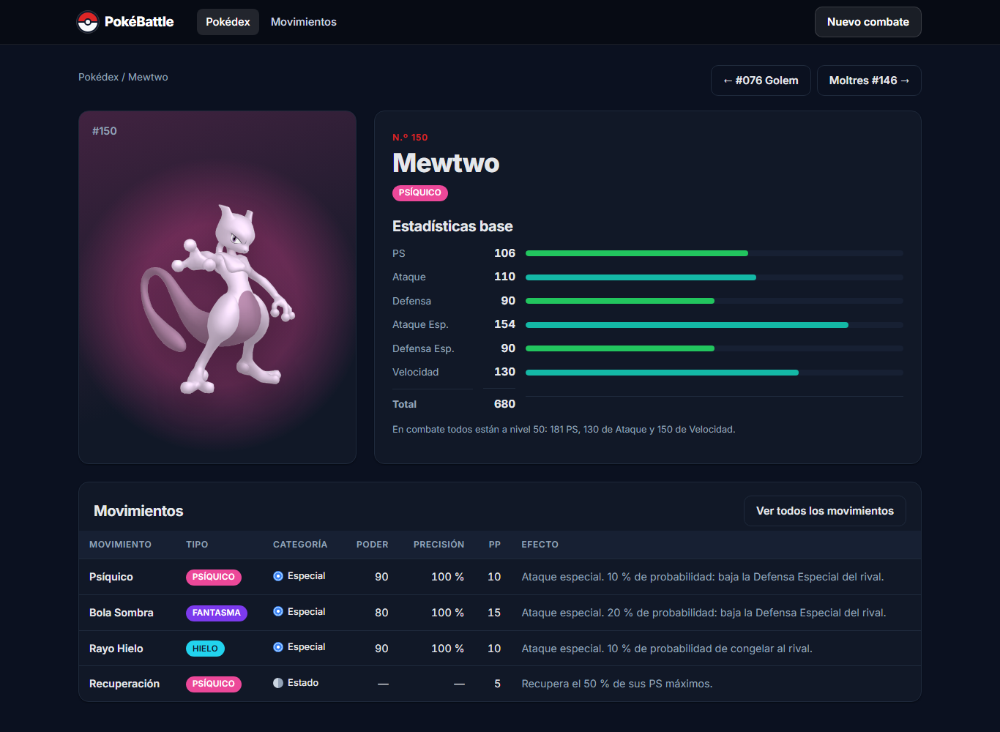

# PokéBattle

Simulador web de combates por turnos al estilo Pokémon, hecho con **FastAPI**, **Jinja2** y **pytest**.

**Autor:** [COMPLETAR] · **Curso:** [COMPLETAR] · **Fecha:** [COMPLETAR]

> Proyecto académico sin fines comerciales. Pokémon y sus nombres pertenecen a Nintendo, Game Freak y The Pokémon Company.

---

## 1. Presentación del proyecto

**Nombre:** PokéBattle.

**Propósito.** Simular combates Pokémon por turnos en el navegador, aplicando reglas parecidas a las de los juegos: tipos, estadísticas, estados alterados, PP y una estrategia para el rival.

**Problema que resuelve.** En un combate Pokémon intervienen muchas reglas a la vez: la fórmula de daño, la tabla de tipos, el orden por velocidad y prioridad, los estados y el azar. Es difícil saber de antemano qué pasará en un enfrentamiento. PokéBattle permite probar equipos y ver turno a turno cómo esas reglas deciden el resultado, con mensajes y animaciones que muestran cada paso en orden.

**Funcionalidad principal.** El usuario elige un equipo de 1 a 6 Pokémon y combate contra un entrenador controlado por la máquina, que lleva la misma cantidad de Pokémon. En cada turno elige un movimiento o un cambio de Pokémon; el servidor procesa la acción con un motor de reglas propio y devuelve el resultado, que la página reproduce paso a paso.

Reglas implementadas:

- Fórmula de daño a nivel 50: STAB, efectividad de tipos, golpes críticos, factor aleatorio y precisión.
- Orden del turno por prioridad y luego por velocidad.
- Cambios de estadística de −6 a +6.
- Estados: quemadura, parálisis, sueño y congelación, con sus inmunidades por tipo.
- PP por movimiento y Forcejeo cuando se agotan.
- Curación, drenaje y retroceso.
- Estrategia del rival: elige el movimiento con más daño esperado (y a veces uno al azar).

Contenido: 22 Pokémon, 12 tipos, 43 movimientos y 6 entrenadores rivales. El jugador es Ethan.

No es un CRUD: la aplicación no administra registros, sino que recibe decisiones del usuario, las procesa con reglas propias y presenta un resultado.

## 2. Tecnologías utilizadas

| Tecnología | Función | Por qué se eligió |
|---|---|---|
| Python 3.13 | Lenguaje de todo el proyecto | Es el lenguaje del curso y permite escribir las reglas del juego de forma clara. |
| FastAPI | Rutas HTTP, formularios y validación | Valida automáticamente los datos de entrada (por ejemplo, `indice: int` responde 422 si llega texto) y facilita manejar errores con páginas propias. |
| Uvicorn | Servidor ASGI | Es el servidor recomendado para ejecutar FastAPI. |
| Jinja2 | Plantillas HTML | Permite herencia de plantillas, macros y filtros, separando la presentación de la lógica. |
| python-multipart | Lectura de formularios | FastAPI la necesita para recibir datos con `Form(...)`. |
| pytest | Pruebas automatizadas | Sintaxis simple con `assert` y buena integración con el `TestClient` de FastAPI. |
| httpx | Cliente HTTP de `TestClient` | Lo usa `TestClient` para simular peticiones a la aplicación. |
| HTML, CSS y JavaScript | Interfaz y animaciones | Sin librerías externas: las animaciones del combate son CSS y un script propio. |
| PokéAPI | Estadísticas oficiales e imágenes | Fuente abierta. Solo se usa en `scripts/fetch_data.py`, no mientras se juega. |

## 3. Arquitectura y organización

```
pokebattle/
├── app/
│   ├── main.py              # Rutas de FastAPI
│   ├── game/                # Lógica del juego (no depende de FastAPI)
│   │   ├── models.py        # Especie, Movimiento, Entrenador, Combatiente y cálculo de estadísticas
│   │   ├── damage.py        # Fórmula de daño, efectividad de tipos y precisión
│   │   ├── battle.py        # Motor de turnos, estados, estrategia del rival y registro de pasos
│   │   ├── descripciones.py # Texto que explica el efecto de cada movimiento
│   │   └── data_loader.py   # Lectura y validación de los JSON
│   ├── data/                # pokemon.json, moves.json, type_chart.json, entrenadores.json, jugador.json
│   ├── templates/           # Plantillas Jinja2
│   └── static/              # css/, js/batalla.js e imágenes
├── scripts/
│   ├── build_json.py        # Genera los JSON de datos
│   └── fetch_data.py        # Descarga estadísticas e imágenes desde PokéAPI
├── tests/                   # Pruebas con pytest
├── docs/capturas/           # Evidencias
├── requirements.txt
└── README.md
```

**¿Dónde están las rutas?** En `app/main.py`. Cada ruta recibe la petición, llama al motor y devuelve una plantilla o una redirección.

| Método | Ruta | Qué hace |
|---|---|---|
| GET | `/` | Pokédex, rivales y selección del equipo |
| GET | `/pokemon/{slug}` | Ficha con estadísticas y movimientos |
| GET | `/movimientos` | Índice de movimientos (filtro opcional `?tipo=fuego`) |
| POST | `/batalla/nueva` | Crea un combate (campo `equipo`, de 1 a 6) |
| GET | `/batalla/{id}` | Pantalla del combate |
| POST | `/batalla/{id}/mover` | Usa el movimiento `indice` (0 a 3) |
| POST | `/batalla/{id}/cambiar` | Cambia al Pokémon `indice` |
| POST | `/batalla/{id}/revancha` | Mismo equipo contra otro entrenador |
| POST | `/batalla/{id}/abandonar` | Abandona el combate en curso |

**¿Dónde está la lógica?** En `app/game/`. Es Python puro: no importa FastAPI, por eso se puede probar sin servidor. `battle.py` aplica las reglas del turno y `damage.py` hace los cálculos.

**¿Cómo se usan las plantillas Jinja2?**

- `base.html` define la cabecera, el aviso de combate en curso y el pie; las demás páginas la extienden con `` y ``.
- `index.html`, `pokemon.html`, `movimientos.html`, `batalla.html` y `error.html` reciben los datos desde la ruta y los recorren con `` y ``.
- `batalla.html` usa macros (``) para dibujar el cuadro de información y el campo de cada lado.
- Se registraron filtros propios en `main.py`: `tipo` (nombre bonito del tipo), `stat`, `categoria` y `describir` (efecto de un movimiento en palabras).
- Los pasos del turno se pasan al navegador con el filtro `tojson`, que escapa el contenido de forma segura.

**Decisiones de diseño.**

- **El turno se registra como una lista de pasos.** Cada cosa que ocurre (un ataque, el daño, un estado, un debilitado) se guarda con su texto, su animación y el estado de los dos lados en ese momento. El servidor es la única fuente de verdad y el JavaScript solo reproduce los pasos.
- **Los pasos se entregan una sola vez.** Si se recarga la página, se ve el estado final sin repetir la animación.
- **El azar es controlable.** El motor recibe un `random.Random`; con la misma semilla el combate se repite igual, lo que permite probarlo.
- **Los combates se guardan en memoria** (diccionario `BATALLAS`). No hace falta base de datos; si el servidor se reinicia, aparece una página de error con un botón para empezar otro.

## 4. Funcionamiento de la aplicación

### Recorrido de la información



1. **Datos que recibe.** El equipo elegido (lista `equipo` con 1 a 6 Pokémon) y, en cada turno, la acción (`mover` o `cambiar`) con un `indice`.
2. **Procesamiento.** `ejecutar_turno` valida la acción, elige el movimiento del rival, ordena las acciones por prioridad y velocidad, calcula el daño con `calcular_dano`, aplica estados y efectos, y resuelve los debilitados. Todo queda registrado como pasos.
3. **Papel de FastAPI.** Recibe el formulario, convierte y valida los tipos de datos, llama al motor, guarda el combate y redirige a la pantalla del combate (patrón POST → redirección → GET, para que recargar no repita la acción).
4. **Papel de Jinja2.** Renderiza la escena con el estado final (vida, estado, PP, historial por turnos) e incluye los pasos en un bloque JSON. El script `batalla.js` los reproduce: escribe los mensajes letra por letra, mueve las barras de vida y ejecuta las animaciones. Tocar la pantalla o pulsar Enter, Espacio o Z adelanta los mensajes.

### Uso paso a paso

1. En `/` se marca de 1 a 6 Pokémon (con buscador y filtro por tipo) y se pulsa **¡Combatir!**.
2. Aparecen Ethan y el entrenador rival, y cada uno envía a su primer Pokémon.
3. En cada turno se elige **Luchar** (un movimiento) o **Pokémon** (un cambio, que gasta el turno). «¿Qué hace cada uno?» abre una ventana con los movimientos del equipo sin salir del combate.
4. Si cae el Pokémon del rival, el entrenador envía el siguiente; si cae el tuyo, debes elegir otro.
5. Gana quien deje al otro sin Pokémon. El cartel final permite una revancha con el mismo equipo.
6. Si se sale del combate, todas las páginas muestran un aviso para volver o abandonarlo.

### ¿Qué ocurre si la información es incorrecta?

| Entrada o situación | Respuesta |
|---|---|
| Equipo vacío | 400: se vuelve a mostrar la Pokédex con «Elige al menos 1 Pokémon para tu equipo.» |
| Más de 6 Pokémon o repetidos | 400 con el motivo; se conserva la selección |
| Pokémon inexistente (`missingno`) | 400 al crear el equipo; 404 en `/pokemon/missingno` |
| Movimiento fuera de rango (`indice=9`) | 400 con página de error y botón «Volver al combate» |
| Índice que no es número (`indice=abc`) | 422, por la validación automática de FastAPI |
| Movimiento sin PP | 400 «¡No quedan PP para ese movimiento!» (si no queda ninguno, se usa Forcejeo) |
| Atacar cuando hay que cambiar, o elegir a un debilitado | 400 con el motivo |
| Combate inexistente o perdido al reiniciar el servidor | 404 con botón «Empezar otro combate» |
| Redirección a otro sitio al abandonar (`volver=//otro.com`) | Se ignora y se redirige a `/` |

## 5. Instalación y ejecución

**Requisitos:** Python 3.11 o superior y conexión a internet para instalar las dependencias.

```bash
git clone https://github.com/jorge-233/Parcial-III.git
cd Parcial-III
python -m venv .venv
.venv\Scripts\activate              # Mac/Linux: source .venv/bin/activate
pip install -r requirements.txt
uvicorn app.main:app --reload
```

Luego se abre **http://127.0.0.1:8000** en el navegador.

Las imágenes de los Pokémon ya vienen incluidas. Opcionalmente, `python scripts/fetch_data.py` vuelve a descargar estadísticas e imágenes desde PokéAPI.

Las imágenes de los entrenadores son opcionales: si se guardan `misty.png`, `brock.png`, `gary.png`, `dawn.png` (Maya), `paul.png`, `iris.png` o `ethan.png` en `app/static/img/trainers/`, se usan automáticamente; si no, se muestra un círculo de color con la inicial.

## 6. Pruebas automatizadas

**Ejecución:**

```bash
pytest -v
```

**Resultado:** 88 pruebas, todas exitosas (`88 passed`).

| Archivo | Qué cubre |
|---|---|
| `tests/test_damage.py` | Efectividad de tipos, inmunidades, STAB, críticos, etapas y precisión |
| `tests/test_battle.py` | Orden del turno, estados, debilitados, cambios, victoria y derrota, estrategia del rival, PP y Forcejeo |
| `tests/test_pasos.py` | Pasos del turno en orden, estado de la escena en cada paso, presentación, congelación y movimientos |
| `tests/test_data.py` | Consistencia de los datos: 22 Pokémon, 12 tipos, 43 movimientos con PP |
| `tests/test_routes.py` | Rutas con `TestClient`: páginas, errores 400/404/422, animación entregada una vez, volver y abandonar |

### Pruebas principales

| Funcionalidad comprobada | Datos usados | Resultado esperado | Resultado obtenido |
|---|---|---|---|
| Funcionalidad principal: orden de los pasos de un turno | Sceptile rival (más rápido) contra Articuno; el rival tiene 1 PS | Sceptile ataca, baja la vida de Articuno, Articuno ataca, Sceptile se debilita y el entrenador envía a Dugtrio | ✅ Exitosa |
| Estado de la escena en cada paso | El mismo combate | En el golpe al jugador el rival aún tiene 1 PS; en el golpe al rival, 0 PS | ✅ Exitosa |
| Ruta de FastAPI | `GET /` | 200 y la página muestra Pokémon, rivales y «¡Combatir!» | ✅ Exitosa |
| Resultado esperado del cálculo de daño | Charizard con Lanzallamas contra Venusaur y Blastoise, sin crítico y con azar 1.0 | x2 contra Venusaur, x0.5 contra Blastoise, más daño al primero | ✅ Exitosa |
| Datos inválidos: equipo | `[]`, 7 Pokémon y `missingno` | 400 con mensaje | ✅ Exitosa |
| Datos inválidos: índice | `indice=9` e `indice=abc` | 400 y 422 | ✅ Exitosa |
| Caso límite: inmunidad | Pikachu con Rayo contra Dugtrio | Daño 0 y efectividad 0 | ✅ Exitosa |
| Prioridad sobre velocidad | Pidgeot con Ataque Rápido contra Sceptile | Pidgeot actúa primero | ✅ Exitosa |
| Congelación | Charizard congelado con azar fijo 0.99 | No puede moverse y el rival no recibe daño | ✅ Exitosa |
| PP y Forcejeo | Charizard con todos los PP en 0 | Usa Forcejeo y pierde 1/4 de sus PS | ✅ Exitosa |
| Tamaño del equipo rival | Equipos de 1 a 6 Pokémon | El rival lleva la misma cantidad, sin repetir | ✅ Exitosa |
| Combate completo repetible | Semilla 11, hasta 500 turnos | Termina con un ganador y el historial es idéntico con la misma semilla | ✅ Exitosa |
| Animación una sola vez | Dos `GET` seguidos a la misma batalla | La primera trae los pasos; la segunda, `null` | ✅ Exitosa |
| Combate perdido | `GET /batalla/noexiste` | 404 con botón «Empezar otro combate» | ✅ Exitosa |
| Abandonar | `POST /batalla/{id}/abandonar` | El combate se borra y el aviso desaparece | ✅ Exitosa |

Las pruebas con azar usan una semilla fija o un generador con valor fijo, para que siempre den el mismo resultado. El listado completo está en el [anexo](#anexo-listado-completo-de-pruebas).

## 7. Evidencias de funcionamiento

**Interfaz principal:** Pokédex con buscador, filtros por tipo, entrenador y rivales.



**Aplicación en ejecución:** combate contra Gary, a la espera de la acción del jugador.



**Resultado del procesamiento:** a mitad del turno, Charizard ya dañó a Zapdos (su barra bajó) y Zapdos responde con Rayo.



**Otras pantallas:** índice de movimientos y ficha de un Pokémon.




**Ejecución de las pruebas con pytest:**


## 8. Conclusiones

[COMPLETAR / REVISAR con tus palabras]

- **Separar la lógica de la web** fue la decisión más útil: como `app/game/` no depende de FastAPI, casi todas las reglas se probaron directamente con pytest, sin levantar el servidor. FastAPI quedó como una capa delgada que valida, llama al motor y devuelve plantillas.
- **El azar era un problema para las pruebas.** Se resolvió pasando el generador aleatorio como parámetro: con una semilla fija el combate es repetible y se pueden comprobar resultados exactos.
- **Mostrar el turno en orden** fue el mayor desafío de la interfaz. Al principio todo el turno aparecía de golpe. La solución fue que el motor registrara cada acción como un paso con el estado de la escena, y que la página los reprodujera uno por uno, sin necesidad de AJAX.
- **Integración FastAPI–Jinja2–pytest:** el `TestClient` permitió comprobar las rutas igual que un navegador (códigos 200, 303, 400, 404 y 422, cookies y contenido HTML).
- **Limitaciones:** los combates viven en memoria, cada Pokémon tiene un solo tipo y algunos movimientos están simplificados respecto al juego original.
- **Mejoras posibles:** dos tipos por Pokémon, clima, habilidades y guardar los combates en una base de datos.

## Créditos

- Datos e imágenes: [PokéAPI](https://pokeapi.co/).
- Pikachu y Eevee compañeros: estadísticas de *Pokémon: Let's Go* (45/80/50/75/60/120 y 65/75/70/65/85/75).

---

## Anexo: listado completo de pruebas

Resultado de `pytest -v`. Cada nombre describe lo que comprueba.

| # | Archivo | Prueba | Resultado |
|---|---|---|---|
| 1 | `test_battle.py` | El rival lleva tantos pokemon distintos como el jugador | ✅ Exitosa |
| 2 | `test_battle.py` | Misma semilla crea la misma batalla | ✅ Exitosa |
| 3 | `test_battle.py` | Hay como maximo 6 entrenadores y todos aparecen al azar | ✅ Exitosa |
| 4 | `test_battle.py` | Equipos invalidos se rechazan | ✅ Exitosa |
| 5 | `test_battle.py` | La revancha cambia de entrenador y restaura la vida | ✅ Exitosa |
| 6 | `test_battle.py` | El mas rapido ataca primero | ✅ Exitosa |
| 7 | `test_battle.py` | La prioridad va antes que la velocidad | ✅ Exitosa |
| 8 | `test_battle.py` | Fuego no se quema ni electrico se paraliza | ✅ Exitosa |
| 9 | `test_battle.py` | La quemadura hace dano al final del turno | ✅ Exitosa |
| 10 | `test_battle.py` | Un pokemon dormido no actua | ✅ Exitosa |
| 11 | `test_battle.py` | Respiro cura la mitad de la vida | ✅ Exitosa |
| 12 | `test_battle.py` | Danza espada sube el ataque en combate | ✅ Exitosa |
| 13 | `test_battle.py` | Onda trueno no afecta a dugtrio | ✅ Exitosa |
| 14 | `test_battle.py` | Al debilitarse el jugador debe elegir otro pokemon | ✅ Exitosa |
| 15 | `test_battle.py` | El cambio voluntario gasta el turno | ✅ Exitosa |
| 16 | `test_battle.py` | El rival envia su siguiente pokemon | ✅ Exitosa |
| 17 | `test_battle.py` | Victoria muestra el mensaje del entrenador | ✅ Exitosa |
| 18 | `test_battle.py` | Derrota muestra el mensaje del entrenador | ✅ Exitosa |
| 19 | `test_battle.py` | El rival puntua mejor el movimiento super eficaz | ✅ Exitosa |
| 20 | `test_battle.py` | El rival siempre elige un movimiento valido | ✅ Exitosa |
| 21 | `test_battle.py` | Un combate completo siempre termina y es repetible | ✅ Exitosa |
| 22 | `test_battle.py` | Usar un movimiento gasta un pp | ✅ Exitosa |
| 23 | `test_battle.py` | Sin pp en ese movimiento no se puede usar | ✅ Exitosa |
| 24 | `test_battle.py` | Sin ningun pp se usa forcejeo con retroceso | ✅ Exitosa |
| 25 | `test_battle.py` | Forcejeo si afecta a fantasma | ✅ Exitosa |
| 26 | `test_battle.py` | El rival no elige movimientos sin pp | ✅ Exitosa |
| 27 | `test_damage.py` | Efectividad de tipos | ✅ Exitosa |
| 28 | `test_damage.py` | Inmunidades dan cero | ✅ Exitosa |
| 29 | `test_damage.py` | Fuego hace mas dano a planta que a agua | ✅ Exitosa |
| 30 | `test_damage.py` | Rayo no afecta a dugtrio pero ataque rapido si | ✅ Exitosa |
| 31 | `test_damage.py` | Movimiento de estado no hace dano | ✅ Exitosa |
| 32 | `test_damage.py` | Stab aumenta el dano | ✅ Exitosa |
| 33 | `test_damage.py` | Golpe critico aumenta el dano | ✅ Exitosa |
| 34 | `test_damage.py` | Misma semilla da el mismo resultado | ✅ Exitosa |
| 35 | `test_damage.py` | Danza espada sube dos etapas y respeta el limite | ✅ Exitosa |
| 36 | `test_damage.py` | Subir ataque aumenta el dano | ✅ Exitosa |
| 37 | `test_damage.py` | Quemadura reduce el ataque fisico | ✅ Exitosa |
| 38 | `test_damage.py` | Un pokemon con hp cero esta debilitado | ✅ Exitosa |
| 39 | `test_damage.py` | Curar no supera el hp maximo | ✅ Exitosa |
| 40 | `test_damage.py` | Precision 100 siempre acierta y sin precision nunca falla | ✅ Exitosa |
| 41 | `test_damage.py` | Bajar precision hace fallar mas veces | ✅ Exitosa |
| 42 | `test_damage.py` | Tipos nuevos fantasma psiquico y roca | ✅ Exitosa |
| 43 | `test_damage.py` | Roca afilada contra charizard es muy eficaz | ✅ Exitosa |
| 44 | `test_damage.py` | Tipo dragon | ✅ Exitosa |
| 45 | `test_data.py` | Hay 22 pokemon con 4 movimientos validos | ✅ Exitosa |
| 46 | `test_data.py` | Cada tipo tiene al menos un pokemon | ✅ Exitosa |
| 47 | `test_data.py` | Pikachu companero tiene mas stats que el normal | ✅ Exitosa |
| 48 | `test_data.py` | Calculo de stats a nivel 50 | ✅ Exitosa |
| 49 | `test_data.py` | Hay 12 tipos y 43 movimientos con pp | ✅ Exitosa |
| 50 | `test_data.py` | Pokemon pedidos con sus tipos | ✅ Exitosa |
| 51 | `test_data.py` | Eevee companero de lets go | ✅ Exitosa |
| 52 | `test_data.py` | Los ataques de hielo pueden congelar | ✅ Exitosa |
| 53 | `test_data.py` | Ethan es el personaje del jugador | ✅ Exitosa |
| 54 | `test_pasos.py` | La presentacion muestra entrenadores antes de los pokemon | ✅ Exitosa |
| 55 | `test_pasos.py` | Pasos en orden rival te deja herido y tu lo derrotas | ✅ Exitosa |
| 56 | `test_pasos.py` | Cada paso trae la foto completa de la escena | ✅ Exitosa |
| 57 | `test_pasos.py` | El ataque lleva el tipo del movimiento para el destello | ✅ Exitosa |
| 58 | `test_pasos.py` | El historial queda ordenado por turnos | ✅ Exitosa |
| 59 | `test_pasos.py` | Los de tipo hielo no se congelan | ✅ Exitosa |
| 60 | `test_pasos.py` | Congelado no puede moverse | ✅ Exitosa |
| 61 | `test_pasos.py` | Congelado se descongela con 20 por ciento | ✅ Exitosa |
| 62 | `test_pasos.py` | Un ataque de fuego descongela al rival | ✅ Exitosa |
| 63 | `test_pasos.py` | Rayo hielo puede congelar | ✅ Exitosa |
| 64 | `test_pasos.py` | Paz mental sube ataque y defensa especial | ✅ Exitosa |
| 65 | `test_pasos.py` | Golpe cuerpo no afecta a gengar | ✅ Exitosa |
| 66 | `test_routes.py` | Inicio responde y muestra pokemon y rivales | ✅ Exitosa |
| 67 | `test_routes.py` | Ficha de un pokemon muestra sus movimientos | ✅ Exitosa |
| 68 | `test_routes.py` | Pokemon inexistente devuelve 404 | ✅ Exitosa |
| 69 | `test_routes.py` | Crear combate redirige a la pantalla de batalla | ✅ Exitosa |
| 70 | `test_routes.py` | La pantalla de batalla muestra los movimientos | ✅ Exitosa |
| 71 | `test_routes.py` | Equipo vacio o demasiado grande se rechaza | ✅ Exitosa |
| 72 | `test_routes.py` | Pokemon inexistente en el equipo se rechaza | ✅ Exitosa |
| 73 | `test_routes.py` | Usar un movimiento avanza el turno | ✅ Exitosa |
| 74 | `test_routes.py` | Movimiento inexistente o texto invalido se rechaza | ✅ Exitosa |
| 75 | `test_routes.py` | Combate inexistente devuelve 404 con pagina amable | ✅ Exitosa |
| 76 | `test_routes.py` | Revancha crea un combate nuevo | ✅ Exitosa |
| 77 | `test_routes.py` | La animacion se entrega una sola vez | ✅ Exitosa |
| 78 | `test_routes.py` | Accion invalida muestra error con boton para volver | ✅ Exitosa |
| 79 | `test_routes.py` | Inicio muestra a ethan y los pokemon nuevos | ✅ Exitosa |
| 80 | `test_routes.py` | La pantalla de batalla tiene la escena y el menu | ✅ Exitosa |
| 81 | `test_routes.py` | Indice de movimientos muestra todos con su efecto | ✅ Exitosa |
| 82 | `test_routes.py` | La pantalla de batalla muestra los pp | ✅ Exitosa |
| 83 | `test_routes.py` | Desde otra pagina se puede volver al combate | ✅ Exitosa |
| 84 | `test_routes.py` | Al terminar el combate ya no se ofrece volver | ✅ Exitosa |
| 85 | `test_routes.py` | La ventana de movimientos esta dentro del combate | ✅ Exitosa |
| 86 | `test_routes.py` | Abandonar borra el combate y quita el aviso | ✅ Exitosa |
| 87 | `test_routes.py` | Abandonar no redirige fuera de la app | ✅ Exitosa |
| 88 | `test_routes.py` | Un combate nuevo reemplaza al que estaba sin terminar | ✅ Exitosa |
